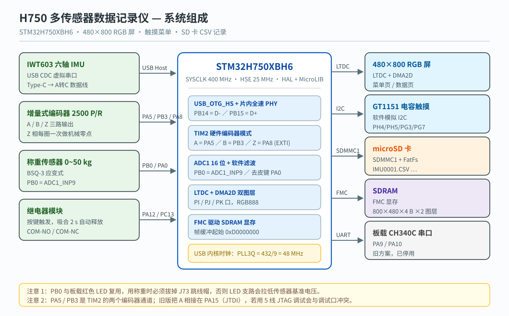
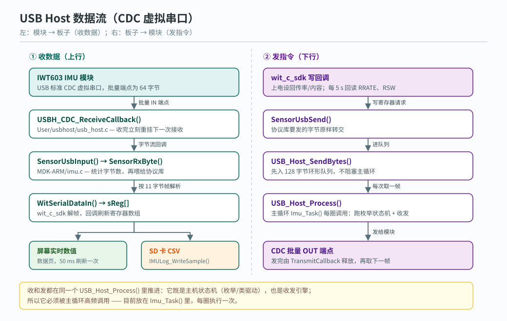
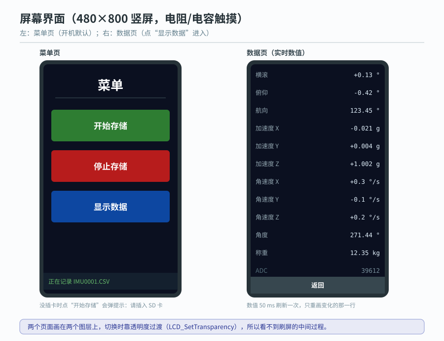

# H750-sensor-datalogger

STM32H750XBH6 上的**多传感器数据采集与记录固件**：IMU 走 **USB Host（CDC 虚拟串口）**、
增量式编码器、称重传感器，数据在 480×800 RGB 触摸屏上显示，并按 50 ms（20 Hz）周期
记录到 SD 卡的 CSV 文件。

> 硬件平台：STM32H750XB + 野火 H7 系列底板（RGB 屏 / SDRAM / SD 卡 / 电容触摸）。



---

## 一、功能

| 模块 | 说明 |
| --- | --- |
| **IMU** | 维特智能 IWT603，通过 **USB Host + CDC 虚拟串口**收数据（不再走串口）。上电后自动把模块设成固定的回传率与回传内容 |
| **编码器** | TIM2 硬件编码器模式（A/B 四倍频）+ Z 相外部中断做机械零点；输出累计计数 / 角度 / 转速 |
| **称重** | ADC1_INP9(PB0) 采集 0~50 kg 称重传感器，支持按键去皮 |
| **显示** | LTDC 480×800 RGB 屏，SDRAM 显存 + DMA2D 加速，双图层实现菜单页 / 数据页切换 |
| **触摸** | GT1151QM 电容触摸（软件模拟 I2C，不依赖触摸驱动库） |
| **记录** | SD 卡 FatFs，CSV 文件 `IMU0001.CSV`、`IMU0002.CSV`… 递增；掉卡自动停止记录并提示 |
| **继电器** | 按键控制，吸合 2 秒后自动释放 |
| **汉字** | 内部 Flash 点阵字库（24×24），不依赖外部字库芯片 |

## 二、引脚分配

| 功能 | 引脚 | 说明 |
| --- | --- | --- |
| IMU USB HOST | **PB14 = D-，PB15 = D+** | USB_OTG_HS + 片内全速 PHY，对应底板 USB-A 口 |
| 编码器 A / B / Z | **PA5 / PB3 / PA8** | A/B 走 TIM2 编码器模式（AF1）；Z 走 EXTI9_5 下降沿 |
| 称重 ADC | **PB0** | ADC1_INP9，16 位。注意 PB0 与板载红色 LED 复用，需拔掉 J73 跳线帽 |
| 去皮按键 | **PA0** | 按下执行去皮 |
| 继电器 IN / 控制键 | **PA12 / PC13** | 按键吸合 2 秒自动释放 |
| 触摸 | **PH4=SCL，PH5=SDA，PG7=RST，PG3=INT** | 软件模拟 I2C |
| SD 卡 | **PC8~PC12 + PD2** | SDMMC1（当前 1 位模式，`SD_USE_4BIT = 0`） |
| 屏背光 | **PD13** | LCD_BL |
| RGB 屏 | PI / PJ / PK 口 | LTDC 数据与同步信号 |
| SDRAM | PD / PE / PF / PG / PH / PI 口 | FMC，显存起始地址 `0xD0000000` |
| 串口（旧方案，未启用） | PA9 / PA10 | 板载 CH340C，仅历史版本使用 |

## 三、目录结构

```
H750_Sensor/
├─ Inc/            工程头文件（main.h、HAL 配置、wit_c_sdk.h / REG.h）
├─ Src/            main.c（应用逻辑）、HAL MSP / 中断、wit_c_sdk.c
├─ MDK-ARM/        Keil 工程 + 模块源码
│   ├─ Project.uvprojx     打开这个
│   ├─ force.c/.h          称重传感器（ADC）+ 全局量
│   ├─ imu.c/.h            IMU 初始化与轮询（USB Host）
│   ├─ relay.c/.h          继电器 + 按键
│   └─ startup_stm32h750xx.s、H750XB_Flash.sct
├─ User/
│   ├─ lcd/        LTDC + DMA2D + 显示屏底层
│   ├─ sdram/      FMC SDRAM 初始化
│   ├─ sd/         SDMMC1 驱动 + imu_sdlog.c（CSV 记录）
│   ├─ encoder/    TIM2 编码器 + Z 相处理
│   ├─ touch/      GT1151QM 触摸
│   ├─ fonts/      内部 Flash 点阵字库（含取模脚本 make_cn_font.ps1）
│   └─ usbhost/    ST USB Host 库 + CDC 类 + HCD 粘合层
├─ Drivers/        STM32H7 HAL + CMSIS
├─ docs/images/    README 用图：系统框图 / 数据流图 / 界面示意图（SVG，可缩放）
└─ README_*.md     各子系统的详细说明（见文末索引）
```

## 四、数据流



```
IMU 模块 USB ──(A转C 数据线)──> 底板 USB HOST 口
     │
     └─ CDC 批量 IN 端点 ─> USBH_CDC_ReceiveCallback() ─> SensorUsbInput()
            └─ SensorRxByte() ─> WitSerialDataIn() ─> sReg[]
                   ├─> 屏幕实时数值（数据页，50 ms 刷新）
                   └─> IMULog_WriteSample() ─> SD 卡 CSV

发指令给模块：wit_c_sdk ─> SensorUsbSend() ─> USB_Host_SendBytes()（发送队列）
                        ─> USB_Host_Process() ─> CDC 批量 OUT 端点
```

## 五、编译与烧录

| 项目 | 值 |
| --- | --- |
| 工具链 | Keil MDK5（ARMCC V5.06 update 6 / AC5），Device `STM32H750XBHx` |
| 器件包 | `Keil.STM32H7xx_DFP` 2.7.0 |
| 目标名 | `H750_UART`（历史遗留名，实际只编译 USB 链路） |
| 输出 | `MDK-ARM/Objects/H750_IMU_USB.hex` |
| 库 | MicroLIB（**堆只有 512 B**，见"关键技术点"） |
| 上次全量编译 | Code 77452 + RO-data 31924 ≈ 107 KB（Flash 128 KB） |

图形界面：Keil 打开 `MDK-ARM/Project.uvprojx`，直接 Build / Download。

命令行编译：

```bat
"C:\Keil_v5\UV4\UV4.exe" -b "MDK-ARM\Project.uvprojx" -t H750_UART -j0 -o build.log
```

**两个必须注意的点**

1. **源码是 GBK 编码**。Keil ARMCC 在中文 Windows 下按 GBK 解析源码，用其它编辑器改完若存成
   UTF-8，会报 `#40: expected an identifier` 或 `#870-D: invalid multibyte character sequence`。
   改完请另存为 ANSI/GBK。
2. **不要在 Keil 与 VSCode 里同时编辑同一个文件**。Keil 不检测外部改动，两边都打开时后保存的
   一方会覆盖对方。约定是只用 VSCode 改、Keil 只负责编译下载；改之前先在 Keil 里关掉对应文件。
   详见 `README_编辑约定.md`。

上电顺序：给底板 DC 供电 → 屏幕进入菜单页 → 插上 IMU 的 USB →（数据页可见数值变化）→
触摸"开始存储"开始记录。

## 六、屏幕与操作

| 页面 | 内容 |
| --- | --- |
| 菜单页 | 三个按钮：**开始存储** / **停止存储** / **显示数据**；底部状态行显示 SD 卡状态与文件名 |
| 数据页 | 实时数值：横滚 / 俯仰 / 航向、加速度 XYZ、角速度 XYZ、编码器角度、称重、ADC 原始值；右下角"返回" |



页面切换用双图层 + 透明度实现，避免整屏闪烁。


## 七、SD 卡记录格式

文件名为 `IMUnnnn.CSV`（8.3 短文件名）。表头：

```
t_ms,roll,pitch,yaw,ax,ay,az,gx,gy,gz,enc_deg,rpm,z_cnt,force_g
```

| 列 | 含义 | 单位 / 精度 |
| --- | --- | --- |
| `t_ms` | 自开始记录起的毫秒数 | ms |
| `roll` / `pitch` / `yaw` | 姿态角 | 度，3 位小数 |
| `ax` / `ay` / `az` | 加速度 | g，4 位小数 |
| `gx` / `gy` / `gz` | 角速度 | 度/秒，2 位小数 |
| `enc_deg` | 编码器角度（以 Z 相为 0 点） | 度，2 位小数 |
| `rpm` | 编码器转速 | 转/分，1 位小数 |
| `z_cnt` | 累计收到的 Z 相次数 | 整数 |
| `force_g` | 去皮后的称重值 | g，按 0~50 kg 标定 |

采样周期 50 ms（20 Hz），每 10 行自动 `f_sync` 一次；拔卡或写失败会自动停止记录，已写入
的数据保留。

## 八、关键技术点

### 1. USB 主机时钟：PLL3 同时供 LTDC 和 USB

H7 的 USB 内核**必须恰好 48 MHz**，而 LTDC 需要 27 MHz。原来的 PLL3 VCO 是 270 MHz，
除不出 48 MHz，所以改成 **VCO = 432 MHz**：

```
PLL3M = 25  PLL3N = 432  ->  VCO = 432 MHz
PLL3R = 16  ->  432/16 = 27 MHz  ->  LTDC（与原来完全一致）
PLL3Q = 9   ->  432/9  = 48 MHz  ->  USB 内核时钟（RCC_USBCLKSOURCE_PLL3）
```

### 2. 片内全速 PHY 必须打开 3.3V 电压检测器

`HAL_PWREx_EnableUSBVoltageDetector()` 不调用，插上设备也不会枚举。

### 3. HCD 事件回调必须桥接到主机库

ST 老版 USB Host 库的状态机在 `HOST_IDLE` 里只看 `phost->device.is_connected`，而该标志只在
库的 `USBH_LL_Connect()` 里被置位；这些 `USBH_LL_xxx()` 事件函数库自己不会主动调用，必须由
应用在 HAL 的 HCD 回调里桥接。`User/usbhost/usbh_conf.c` 末尾实现了这 5 个回调：

```
HAL_HCD_Connect_Callback      -> USBH_LL_Connect
HAL_HCD_Disconnect_Callback   -> USBH_LL_Disconnect
HAL_HCD_PortEnabled_Callback  -> USBH_LL_PortEnabled
HAL_HCD_PortDisabled_Callback -> USBH_LL_PortDisabled
HAL_HCD_SOF_Callback          -> USBH_LL_IncTimer
```

漏掉这层桥接的典型现象：屏幕一直停在"等待设备"，插拔模块没有任何反应。

### 4. 静态内存池代替 malloc

工程用 MicroLIB，堆只有 512 B，主机库内部的 `USBH_malloc / USBH_free` 被替换成
`usbh_conf.c` 里的静态内存池，不碰堆。

### 5. CDC 类请求容错

部分虚拟串口设备不实现 `GET_LINE_CODING`（会返回 STALL），`usbh_cdc.c` 里做了容错：该请求
失败时不再把主机打进错误态，而是当作类可用继续运行。

## 九、上电后对模块的配置

`MDK-ARM/imu.c` 在枚举成功后（`IMU_SETUP_ON_BOOT = 1`）发送：

```c
WitSetOutputRate(RRATE_100HZ);                 /* 回传率寄存器 */
WitSetContent(RSW_ACC | RSW_GYRO | RSW_ANGLE); /* 回传内容：加速度 + 角速度 + 角度 */
```

之后每 5 秒回读一次 `RRATE` / `RSW` 做校验；若模块没有按预期回传，最多自动纠正 3 次。
连续 3 秒收不到任何字节时，会发一次"读加速度"做探活。

## 十、已知问题 / 待办

- `Src/main.c` 里读编码器的 `Encoder_ReadDelta()` / `Encoder_UpdateSpeed()` 被
  `#if (ENCODER_ENABLE == 1)` 包住，而 `ENCODER_ENABLE` 目前没有在工程里定义，因此这两个调用
  不会被编译：`s_total` 始终为 0，数据页的"角度"、转速、累计计数都不会变化。需要把该宏定义
  到工程里，或在 50 ms 任务里直接调用。
- `LCD_UpdateUsbStatus()` 目前没有被调用（死代码），屏幕上的 USB 状态行 / VID:PID 不刷新；
  `Encoder_ReadPins()` 也是空实现，`ENCODER_PIN_TEST` 引脚观察模式不可用。

## 十一、相关文档

| 文件 | 内容 |
| --- | --- |
| `README_编辑约定.md` | VSCode / Keil 分工与"文件被覆盖"的坑 |
| `README_移植说明.md` | 从维特官方 F103 例程移植到 H750 的对应关系（早期串口方案） |
| `README_LCD显示移植说明.md` | LTDC + SDRAM + DMA2D + 字库移植细节 |
| `README_SD卡记录说明.md` | SD 卡 / FatFs / CSV 记录的详细说明与排查 |
| `README_USB主机方案.md` | USB Host + CDC 方案的实现记录、排查表与回退方法 |

## 十二、第三方代码与许可

| 组件 | 来源 / 许可 |
| --- | --- |
| `Drivers/`（STM32H7 HAL + CMSIS） | STMicroelectronics，BSD-3-Clause |
| `User/usbhost/`（USB Host 库 + CDC 类） | STMicroelectronics，随 HAL 发布 |
| `User/fatfs/`（FatFs） | ChaN，FatFs License（BSD 风格） |
| `Inc/wit_c_sdk.h`、`Src/wit_c_sdk.c` | 维特智能官方 SDK，协议库原样使用 |
| 其余应用代码（`main.c`、`force.c`、`imu.c`、`relay.c`、`User/` 下各驱动） | 本项目作者 |
